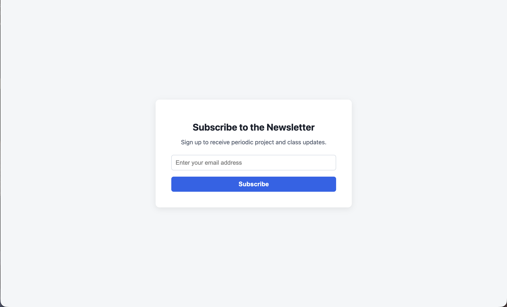
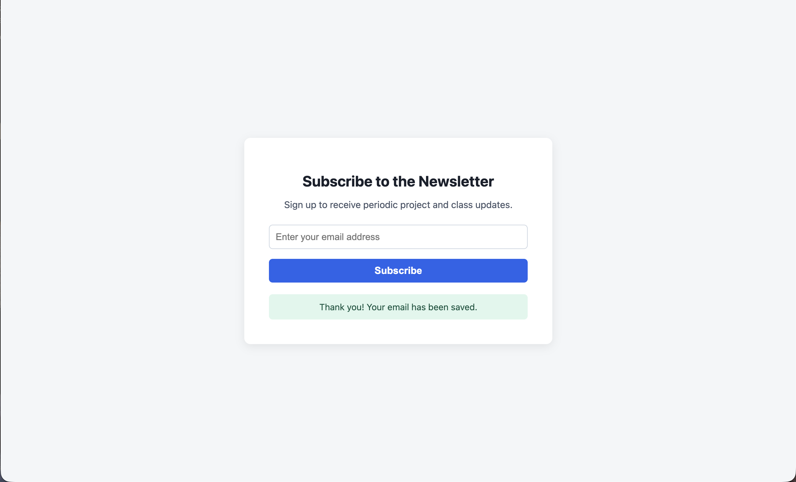
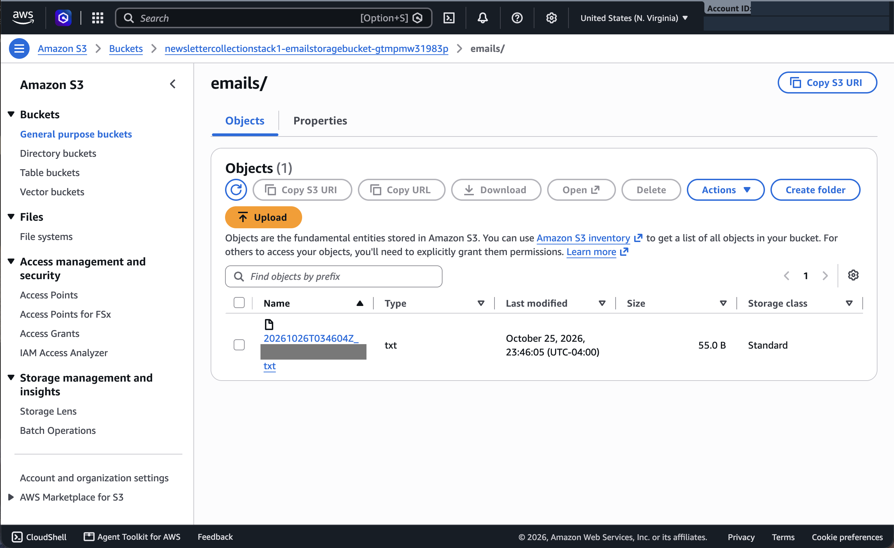

# Newsletter Sign-Up Site on AWS

A small web app that collects newsletter sign-ups and saves each one to a private Amazon S3 bucket. It runs on AWS Elastic Beanstalk, and the storage is defined in an AWS CloudFormation template.

Course project for Foundations of Cloud Computing at UNC Charlotte (October 2026), built and tested in the AWS Academy sandbox.

## How it works

```
Visitor -> Elastic Beanstalk (Flask app) -> S3 bucket (one text file per sign-up)
```

1. A visitor enters their email on the sign-up page.
2. The Flask app writes a small text file to S3 with the email and a UTC timestamp.
3. The page confirms the sign-up was saved.

## What's in this repo

| File | Purpose |
|---|---|
| `template.yaml` | CloudFormation template that creates the S3 bucket and the Elastic Beanstalk application |
| `application.py` | Flask app that serves the form and saves sign-ups to S3 with boto3 |
| `requirements.txt` | Python dependencies |
| `screenshots/` | Proof of the working deployment |

## Security choices in the template

- The bucket is encrypted at rest with SSE-S3 (AES-256).
- All four public access block settings are on, so the bucket and its files can't be made public.
- The bucket name isn't hardcoded. The app reads it from the `S3_BUCKET_NAME` environment variable.

## How I deployed it

1. Created a CloudFormation stack from `template.yaml`. This made the encrypted S3 bucket and the Elastic Beanstalk application.
2. Launched the Elastic Beanstalk environment for the app and deployed `application.py` and `requirements.txt` to it. The environment itself isn't defined in the template.
3. Opened the default Elastic Beanstalk URL, submitted a test sign-up, and confirmed the file showed up in the bucket.

## Proof it worked

Sign-up form on the live Elastic Beanstalk URL:



After submitting:



The saved file in the S3 bucket (account details and email hidden):



## My role

The app code and template were generated with Gemini. I reviewed them, deployed the stack, and tested the full flow end to end.

## Known limitations

This was a class project, and the code is published as it was deployed. If I took it further, I would fix these:

- The template doesn't create the Elastic Beanstalk environment or its IAM role, so the deployment isn't fully infrastructure as code yet.
- The email address is used in the S3 file name. A random ID would be safer.
- The email is only checked by the browser, not by the server.
- Error messages show the raw exception text to the visitor.
- `debug=True` is set for local runs and should be off anywhere public.

The sandbox environment has been shut down, so there is no live link.
